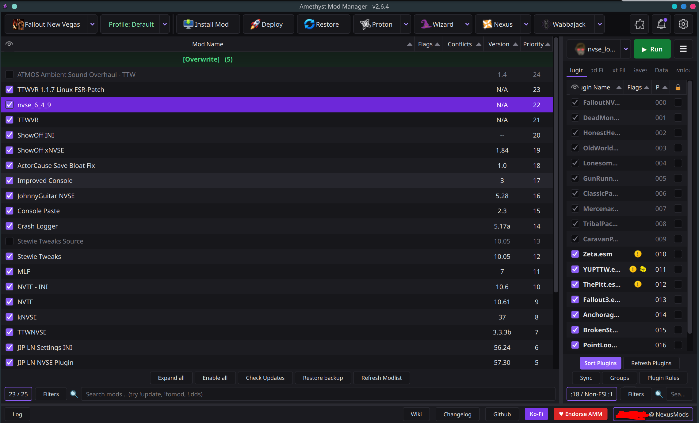

# TTWVR on Linux with SteamVR and the Steam Frame – step by step

This guide gets **Tale of Two Wastelands VR** (TTWVR, "A Tale of Two Realities") running on Linux
with a **Steam Frame** through **SteamVR**, including working FSR upscaling. The mod manager used is
**Amethyst**.

It builds on the reference project
[ethanfel/ttwvr-linux](https://github.com/ethanfel/ttwvr-linux). That project targets
Fluorine + WiVRn + NVIDIA. This guide reuses its verified building blocks for
SteamVR + Steam Frame + AMD. The build script downloads the reference project at the tested commit,
so it is not bundled here.

> **Tested on one system only** (see below). Other GPUs, distributions, mod managers or versions
> may behave differently. Every step can be undone.

## What's in this folder

| Path | Contents |
|---|---|
| `README.md` | This guide |
| [fsr/build_fsr.py](fsr/build_fsr.py) | Builds the FSR pieces from your own `TTWVR.dll` (step 6) |
| [fsr/ROLLBACK.md](fsr/ROLLBACK.md) | How to undo the FSR setup |
| [tools/performance.sh](tools/performance.sh) | CPU boost / performance mode on, off, status |

No game or mod files are included.

## Tested with

| Component | Version |
|---|---|
| GPU | AMD Radeon RX 7800 XT (Mesa / RADV) |
| Headset | Steam Frame, SteamVR beta 2.19.4 |
| Proton | `proton-cachyos-wineopenxr-fix` (`cachyos-11.0-20261015-slr`) |
| Mods | Amethyst Mod Manager 2.6.3, TTW 3.4, TTWVR **1.1.7**, xNVSE |

---

## Step 1: Games and TTW (without VR)

1. Install **Fallout 3** and **Fallout: New Vegas**, each with **all DLCs**, through Steam.
   Start each game once, then close it.
2. In Amethyst, install these mods through the GUI (**Wizard -> Setup and Installers**), in this order:
   1. **xNVSE**
   2. **4GB patcher**
   3. **Tale of Two Wastelands 3.4**, with all of its requirements

   Do **not** use **"Root folder install"** for any mod. Otherwise files end up in the game folder
   instead of `Data/`, and plugins are missing.
3. In the right column (tab **Plugins**), click **Sort Plugins**, then **Sync**, then **Deploy**.
   The right column must now list the plugins: `FalloutNV.esm`, the DLCs, `Fallout3.esm`,
   `Anchorage.esm`, … and the TTW plugins. If it is empty, the game will not find them.

   If the column stays empty, the profile is missing its `plugins.txt`. Create an empty one, then
   click **Refresh Plugins**, **Sort Plugins**, **Sync** and **Deploy** again:
   ```bash
   touch ~/Games/Amethyst/Fallout\ New\ Vegas/profiles/default/plugins.txt
   ```
   (Use your profile name instead of `default` if it is different.)
4. **Test without VR:** in Amethyst choose **`nvse_loader.exe`** → **Run**. The **TTW main menu**
   must appear. If it does, quit the game.

Only continue once this works. VR problems are much harder to find when TTW itself is not
running cleanly.

## Step 2: Set up Proton

The tested Proton build contains an OpenXR fix that TTWVR needs.

1. Download `proton-cachyos-wineopenxr-fix.tar.gz`. It comes from the Discord channel named in
   the reference project ([docs/requirements.md](https://github.com/ethanfel/ttwvr-linux/blob/52a6cfce4c3a07e3873e052798b0b65a395595d0/docs/requirements.md), section
   "Proton"). You need Discord access for it.
2. Extract the **complete** archive into `~/.local/share/Steam/compatibilitytools.d/`.
   The folder must contain `proton` and `version`.
3. Restart Steam. Then Fallout: New Vegas → Properties → Compatibility → select
   `proton-cachyos-wineopenxr-fix`.

Other Proton versions are **not** tested with this guide.

## Step 3: Set up SteamVR

1. Install SteamVR. The current beta (2.19.4) worked without problems.
   - Version **2.19.3** has a bug where the headset loses its connection
     ([SteamVR-for-Linux #1067](https://github.com/ValveSoftware/SteamVR-for-Linux/issues/1067)).
     If you are on 2.19.3: SteamVR → Properties → Betas → branch **`linux-temp`**.
2. In the SteamVR settings → **Video**:
   - **Render resolution: Custom 100 %**. TTWVR sets the game's image size itself (step 6.4).
     - Sometimes Fallout: New Vegas does not show up in the per-application settings. In that
       case, set the resolution to 100 % for **all** applications.
     - You can also change it in the headset while streaming, though that is a bit fiddly.
   - Refresh rate: **90 Hz** is a good start. 120 Hz is usually too much for this game.

> **Check these values before playing.** SteamVR sometimes resets them on its own. In my case
> that was often the reason when performance was suddenly bad.

## Step 4: Steam launch options

Fallout: New Vegas → Properties → General → **Launch options**. Enter this line. It already
includes everything needed for FSR:

```
PROTON_USE_WOW64=1 PROTON_ENABLE_NVAPI=1 PROTON_HIDE_NVIDIA_GPU=0 DXVK_CONFIG="d3d11.disableDirectImageMapping = True" WINEDLLOVERRIDES="d3d9,d3d11,dxgi,d3dcompiler_47=n,b" DISABLE_TTWVR_NEURAL_RENDERING=1 PROTON_FSR4_UPGRADE=0 PROTON_DLSS_UPGRADE=0 PROTON_FFX3_UPGRADE=0 PROTON_FFX4_UPGRADE=0 PROTON_XESS_UPGRADE=0 PROTON_USE_OPTISCALER=0
```

| Part | Purpose |
|---|---|
| `PROTON_USE_WOW64=1` | **Most important part.** Without it TTWVR cannot load SteamVR's OpenXR runtime, falls back to OpenVR, and arms and hands are twisted. |
| `DXVK_CONFIG=…` | Required for TTWVR by the reference project |
| `WINEDLLOVERRIDES=…` | Loads the patched DXVK and the shader compiler from step 6 |
| `DISABLE_TTWVR_NEURAL_RENDERING=1`, `PROTON_*_UPGRADE=0` | Stops Proton from replacing the built-in FSR |

Amethyst passes these launch options on automatically when it starts the game.

> I'm not 100 % sure that every part is needed. This is the combination that worked.
> `PROTON_USE_WOW64=1` is definitely required.

## Step 5: Install TTWVR and start in VR

1. **TTWVR 1.1.7**: get the complete original archive from the author's Discord
   ([community invite](https://discord.com/invite/ttwvr)) and install it in Amethyst, together
   with **all** requirements TTWVR lists. Again, no "Root folder install".
   - The FSR patches in step 6 work **only with exactly 1.1.7**. The original `TTWVR.dll` must
     have this SHA-256: `119a085a5b0101f0618b8e076a421b4b89e30d72d9b6eae874f4e5af7bd3fb27`
2. **Sort Plugins** → **Sync** → **Deploy**. The TTWVR plugins must show up in the right column.
3. Start SteamVR and connect the headset. Then in Amethyst choose **`nvse_loader.exe`** → **Run**.

**First check:** after the game starts, the log at
`~/.local/share/Steam/steamapps/compatdata/22380/pfx/drive_c/users/steamuser/Documents/My Games/FalloutNV/TTWVR.log`
must contain:

```
VR backend: OpenXR
```

If it says OpenVR, `PROTON_USE_WOW64=1` is missing (step 4).

## Step 6: Enable FSR

TTWVR has FSR built in, but on Linux it is off. The log says
`vulkan-1.dll is not loaded … the upscaler (DLSS/FSR) is off`. FSR needs three building blocks from
the reference project:
- a patched `TTWVR.dll`,
- a patched 32-bit DXVK,
- Microsoft's shader compiler `d3dcompiler_47.dll`.

> **DLSS** only works on NVIDIA RTX cards. On AMD, use FSR.

### 6.1 Build

You need these build tools. On Arch, for example:
`git`, `python` (3.11+), `meson`, `ninja`, `glslang`, `mingw-w64-gcc`.

The script only reads your original `TTWVR.dll`, changes nothing in the game and writes everything
to `fsr/out/`. It downloads three things from GitHub:
- the reference project at commit `52a6cfc`, into `fsr/reference/`,
- DXVK (revision `cf0a0d9`),
- the compiler (fixed checksum).

This takes a few minutes. Run it from this folder:

```bash
python3 fsr/build_fsr.py "<path to your mod>/TTWVR/NVSE/Plugins/TTWVR.dll"
```

Without a path it uses the Amethyst default
`~/Games/Amethyst/Fallout New Vegas/mods/TTWVR/NVSE/Plugins/TTWVR.dll`.

At the end it prints checksums. The patched `TTWVR.dll` **must** be
`ae7dc0d7ba94651af0ccd729122f623d3dbdf0b85c6c787838c04bbc721135d6`, otherwise the script stops.
The DXVK DLLs are usually reported as "DIFFERENT from author build". That is normal: they depend on
your compiler version. Source code and patches are the same.

If you use a different mod manager, the steps below work the same way: install the folder
`fsr/out/TTWVR 1.1.7 Linux FSR-Patch` as a mod that overrides TTWVR. This is untested.

### 6.2 Install

Close the game.

**a) Three DLLs into the game folder** (next to `FalloutNV.exe`). `cp -n` overwrites nothing:

```bash
G=~/.local/share/Steam/steamapps/common/Fallout\ New\ Vegas
D=fsr/out/dependencies
cp -n "$D/dxvk/d3d9.dll" "$D/dxvk/dxgi.dll" "$G/"
cp -n "$D/compiler32.dll" "$G/d3dcompiler_47.dll"
```

**b) The patch mod in Amethyst:**

```bash
cp -rn "fsr/out/TTWVR 1.1.7 Linux FSR-Patch" ~/Games/Amethyst/Fallout\ New\ Vegas/mods/
```

It contains `NVSE/Plugins/TTWVR.dll` (patched) and `NVSE/Plugins/d3d11.dll` (patched DXVK).
The `d3d11.dll` **must** be in this folder. The game looks for the dependencies of `TTWVR.dll` in
the plugin folder, not in the game folder.

In Amethyst, enable the mod and give it a **higher priority** than TTWVR, so it wins the conflict.
In Amethyst's default view the highest priority is at the top, so the patch mod appears **above**
TTWVR. Then **Deploy**.



**c) Launch options:** already set in step 4.

### 6.3 Check

Start the game and load a save.

- `TTWVR.log` **no longer** shows `vulkan-1.dll is not loaded` or
  `the upscaler (DLSS/FSR) is off`.
- Detailed check while the game is running:
  ```bash
  python3 fsr/reference/ttwvr-linux/tools/inspect_ttwvr_upscaler.py $(pgrep -f FalloutNV.exe | head -1)
  ```
  Expected: `"native_fsr_active": true` and `"native_fsr_failed": false`.

### 6.4 Settings

In TTWVR's VR menu:
- **Upscaler = FSR**
- **Upscaler Level:** Quality (sharper) / Balanced / Performance (faster)
- **Resolution:** with FSR this is the **output** size per eye (100 % = 2944×2208).
- **Sharpness:** to taste.

The values are stored in `TTWVR.ini` (with Amethyst: `mods/TTWVR/NVSE/Plugins/TTWVR/TTWVR.ini`).
Only edit the file while the game is closed, otherwise the menu overwrites it.

What worked best for me is in [In my case](#in-my-case).

## Step 7: Controller bindings

TTWVR only ships bindings for Oculus Touch and Valve Index. SteamVR translates them to the Frame
automatically. That works, except that the **left Y button is missing**. Fix it like this:

1. Keep SteamVR and the game running.
2. SteamVR settings → **Controllers → Manage Controller Bindings**
   (you may need to enable "Advanced Settings" first).
3. Choose Fallout: New Vegas → **Custom** → **Edit**.
4. **Left d-pad, up:** add a binding, mode "Button", and for "Click" choose **`secondary_click`**.
5. **Save.**

**Why the bumpers also fire the trigger:** the Touch controller has no bumpers, so SteamVR's
automatic translation puts the trigger on both the Frame's trigger and its bumper. If that bothers
you, remove the `trigger` binding from the bumpers in the same screen. They are then free for
something else, for example VATS.

## Performance tips

- **CPU at full speed.** This game mostly runs on one CPU core, so CPU clock matters a lot:
  ```bash
  bash tools/performance.sh status   # show only
  bash tools/performance.sh on       # boost on + governor "performance" (asks for sudo)
  bash tools/performance.sh off      # back to power saving
  ```
  This lasts until the next reboot. Keep an eye on the CPU temperature.

  The script is only a starting point. It works well on my system, but you will probably need to
  adjust it for yours. Treat it as a tip, not a requirement.
- **90 Hz** instead of 120 Hz.
- Put the Steam Link adapter **in line of sight** of the play area. A USB 3 extension cable helps
  with placement.

## In my case

On my system (Threadripper 2950X + RX 7800 XT) the **CPU** was the bottleneck, not the GPU. In VR
the game draws every frame twice, mostly on one core. It usually ran at about 40–45 fps and still
felt good as long as it stayed even.

Because of that:
- **Best result: Resolution 150 %, Balanced, Sharpness 50–60 %.** A lower resolution did **not**
  make it smoother, since the GPU was not the limit.
- **More than 150 % is pointless:** at 200 % FSR 4 refuses the size and TTWVR falls back to the
  older FSR 3.1.

With a faster CPU or a weaker GPU this can look quite different.

## Troubleshooting

| Problem | Cause / fix |
|---|---|
| Arms and hands twisted | `PROTON_USE_WOW64=1` is missing. The log then does not show `VR backend: OpenXR`. |
| Headset loses connection, crash | SteamVR 2.19.3 bug → branch `linux-temp` or a newer beta |
| TTW main menu does not appear, plugins missing | Right column in Amethyst empty → Sort Plugins, Sync, Deploy. No mod installed with "Root folder install". |
| Performance suddenly bad | SteamVR resolution / refresh rate reset itself (step 3) |
| `vulkan-1.dll is not loaded` | Patched `TTWVR.dll` not active: check the patch mod in Amethyst |
| `the helper exited while starting` | `d3d11.dll` is missing from `NVSE/Plugins/` of the patch mod (step 6.2 b) |
| Frame rate drops to 60 Hz or lower | Try 90 Hz instead of 120 Hz |
| Stutter despite FSR | Usually CPU, see [Performance tips](#performance-tips) |

Logs:
- TTWVR: `…/compatdata/22380/pfx/drive_c/users/steamuser/Documents/My Games/FalloutNV/TTWVR.log`
  (previous run: `TTWVR-prev.log`)
- SteamVR: `~/.local/share/Steam/logs/`
- Proton (per launch): `~/.cache/AmethystModManager/launch-logs/`

## Undo everything

1. **FSR:** see [fsr/ROLLBACK.md](fsr/ROLLBACK.md).
   - Delete the three DLLs from the game folder.
   - Disable the patch mod and deploy.
   - Shorten the launch options back to everything up to and including `DXVK_CONFIG=…`.
2. **Controllers:** in SteamVR, select "Default" again for Fallout: New Vegas.
3. **SteamVR branch / resolution:** change them back in SteamVR.

## While playing

- **Do not update TTWVR** while the patch mod is active. The patched DLL only fits 1.1.7 and would
  override a new version.
- **Multiplayer:** the patched DLL has a different build ID. You can only play together with people
  using the same patch.
- **Back up your saves** now and then:
  `…/compatdata/22380/pfx/drive_c/users/steamuser/Documents/My Games/FalloutNV/Saves`

## Share your experience

This guide was tested on one system only. If you try it, please share how it went: what worked,
what didn't, and which hardware and versions you used. Corrections, tips for other GPUs or
distributions, and improvements to the guide are very welcome. Feel free to open an issue or
send a pull request.

## License and sources

- This guide and its scripts are licensed under the [GPL-3.0](LICENSE).

- Reference project: [ethanfel/ttwvr-linux](https://github.com/ethanfel/ttwvr-linux), GPL-3.0.
  `build_fsr.py` downloads it unmodified at commit `52a6cfc` and uses its patcher and DXVK build.
- DXVK: [doitsujin/dxvk](https://github.com/doitsujin/dxvk), revision `cf0a0d9`, with the two
  patches from `reference/…/patches/`
- This repo distributes **no** game or mod files. Everything is built from your own files.
